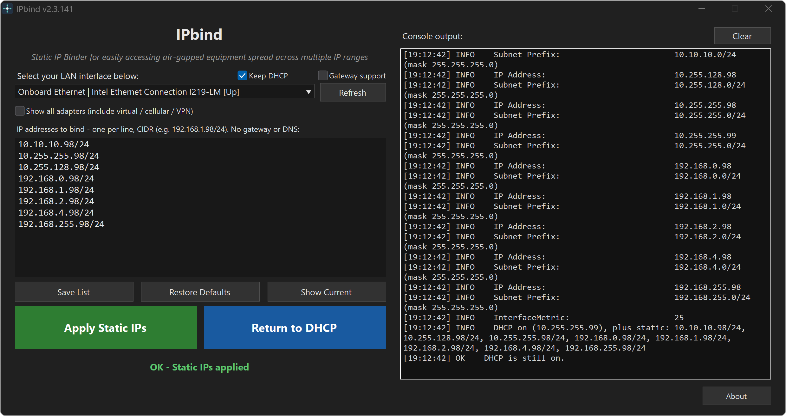

# IPbind

One-click Static IP Binder for easily accessing air-gapped equipment spread across multiple IP ranges.

A compiled .NET WinForms tool that binds a set of static IPv4 addresses onto one chosen LAN interface so you can reach gear that lives on different `/24` subnets, then revert that interface to DHCP with one click.

By default IPbind sets no gateway and no DNS. If one of your addresses needs to reach beyond its subnet, tick **Gateway support** and pick that address, then enter its gateway and up to two DNS servers. The gateway gets a high route metric, so it won't take over internet traffic from your Wi-Fi or office network. IPbind remembers the setting, and Return to DHCP clears it from the interface.

App created by [Andy Rostad](https://github.com/arostad).  Released under the [MIT License](https://github.com/arostad/IPbind/blob/main/LICENSE).

 

Current version: **2.3.124**

## Download

### Download installer: [IPbind-Installer-v2.3.124.exe](https://github.com/arostad/IPbind/releases/download/latest/IPbind-Installer-v2.3.124.exe)

The installer is recommended. It installs per-user under LocalAppData. IPbind asks for administrator approval when it starts, because Windows requires it to change adapter settings.

Prefer a single file? Download the portable version: [IPbind-Portable.exe](https://github.com/arostad/IPbind/releases/download/latest/IPbind-Portable.exe)

## Screenshot

  

## Privacy

IPbind does not upload your address list, adapter choices, or anything that identifies your computer. Your configuration stays in your Windows user profile. The only network call is an update check (at launch or from About), which asks for the latest version number. The check goes to a small Cloudflare Worker run by me (ipbind-update-pings.dataspike.workers.dev). If that can't be reached, IPbind asks GitHub for the same version file instead. That check bumps a simple daily update check count by country so I can see rough usage; the connection's IP address and user-agent are not stored. Like any web request, your IP address is seen by Cloudflare or GitHub when the connection is made. IPbind itself sends no identifier, and the counter keeps only the country. You can turn off the automatic check at launch during installation ('Check for updates at launch'). When it's off, IPbind makes no network calls on its own; updates are checked only when you click Check for updates in About. When an update is available, the file downloads directly from the IPbind GitHub repository. Downloading an update connects only to GitHub and happens only after you choose to update. Binding or reverting addresses is a local `netsh` action on your machine and does not phone home.

